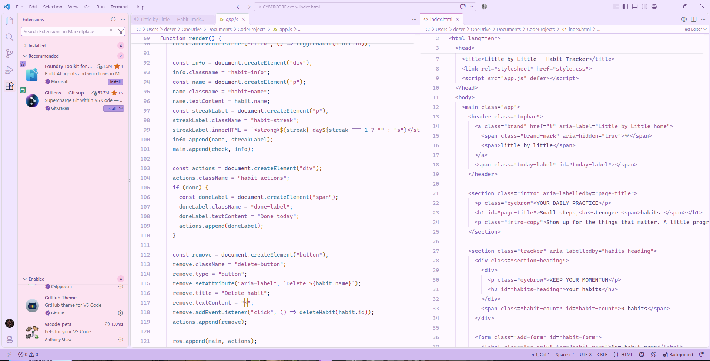

# ♡ cyberstudios / themes.exe ✧

**`dream in pixels. create without limits.`**

☁️　🎀　🖥️　🫧　💿　✧　🐈‍⬛

*somewhere between a daydream and your next workspace.*

---

### ୨୧ hello, palette! ♡

**Your workspace deserves to be cute, too.**

Welcome to the **CyberStudios theme collection**, a little wardrobe for the places where you code, model, experiment, and lose track of time.

Some days call for cotton candy and cloud-colored windows. Others want midnight violet, forest green, warm bronze, or a quiet slab of stone. There is room for all of them here.

Pick the atmosphere that feels like somewhere you want to create.

### 🪟 choose your window

| ♡ Collection | What's inside | Open the folder |
|---|---|---|
| 🖥️ **VS Code** | Color-theme source projects and the original Cotton Candy settings presets | [Enter the code room →](vscode/) |
| 🧊 **Blender** | The Cotton Candy Blender project guide, with its Soft and Vivid editions | [Enter the 3D room →](blender/) |

*One studio. Different windows. Plenty of room for another idea.*

---

### 💻 a little color between the lines

The [VS Code collection](vscode/) includes eight standalone theme source projects, plus the original **Cybercore Cotton Candy** presets.

| Theme | Atmosphere | Find your corner |
|---|---|---|
| 🎀 **Cybercore Cotton Candy** | Light · baby pink, lavender, powder blue, and pearl white · Soft & Vivid | [Open Cotton Candy](vscode/cybercore-cotton-candy/) |
| 💜 **Cy Afterhours** | Dark · aubergine, orchid, and electric lilac | [Open Cy Afterhours](vscode/cy%20afterhours/) |
| 🐈‍⬛ **Byte Terminal** | Dark · graphite, cyan, and mint | [Open Byte Terminal](vscode/byte%20terminal/) |
| 🫧 **Aero Lagoon** | Light · glacier blue, pearl, and deep teal | [Open Aero Lagoon](vscode/aero%20lagoon/) |
| 🌸 **Rose Quartz** | Light · warm cream, dusty rose, and plum | [Open Rose Quartz](vscode/rose%20quartz/) |
| 🔥 **Obsidian Forge** | Dark · warm charcoal, bronze, and pale steel | [Open Obsidian Forge](vscode/obsidian%20forge/) |
| 🌌 **Steel Horizon** | Dark · midnight navy, slate, and brushed blue | [Open Steel Horizon](vscode/steel%20horizon/) |
| 🌿 **Timberline** | Dark · forest, olive, and brass | [Open Timberline](vscode/timberline/) |
| 🪨 **Concrete Day** | Light · stone, graphite, and slate blue | [Open Concrete Day](vscode/concrete%20day/) |

Cotton Candy uses VS Code settings presets. The other eight folders contain independent color-theme source projects. Open the individual README for the files, requirements, and installation steps that belong to that theme.

### 🎀 the original little daydream

*Cybercore Cotton Candy in VS Code. Baby-pink sidebars, lavender windows, a pearl-white editor, and a little powder-blue sky for the terminal.*

**♡ Soft** keeps the gentler mauve, violet, and blue syntax colors. **✧ Vivid** brings richer orchid and violet accents into the same pastel interface.

**[Explore the original Cotton Candy collection →](vscode/cybercore-cotton-candy/)**

---

### 🧊 a daydream with a project file

**[♡ Cybercore Cotton Candy for Blender](blender/cybercore%20cotton%20candy/)** brings the collection's pastel identity into the 3D workspace: pink sidebars, lavender controls, pearl-white editors, and powder-blue animation spaces.

The project guide introduces **Soft** and **Vivid**, explains the theme files, and keeps its installation and compatibility notes together. Start there for the current project contents.

*For the default cube, the ambitious node tree, and the “one more adjustment” at 2 AM.*

---

### 💾 bring a little atmosphere home

1. Choose **VS Code** or **Blender** above.
2. Open the theme folder that catches your eye.
3. Read its README for the actual files, installation method, and tested compatibility.
4. Follow that project's setup steps and make yourself at home.

The folders and their READMEs are the place to check current source files, previews, and downloadable packages as each project grows.

### 🫧 make something of your own

Palette experiments, thoughtful fixes, and independent forks are welcome. Start with the [contribution guide](../CONTRIBUTING.md), keep the [Code of Conduct](../CODE_OF_CONDUCT.md) nearby, and use the [private reporting process](../SECURITY.md) for security concerns.

Check the [repository license](../LICENSE) and any project-specific notices before reusing material. Artwork keeps its existing licensing; CC BY 4.0 applies only to files explicitly designated through the [artwork opt-in notice](../assets/LICENSE).

---

### 🐈‍⬛ a note from the studio

Cy brings another idea. Byte looks for somewhere comfortable to nap. Somewhere between them, another workspace gets a personality of its own.

**Made for the curious, the creative, and the ghosts in the machine.** ✧

**[♡ Back to CyberStudios](../README.md)** · **[💿 Explore the Wiki](https://cyberthreed.github.io/CyberStudios/)**

*Stay curious. Stay creative. Stay a little unreal.*

---

**♡ CYBERSTUDIOS ✧**

`made of pixels, daydreams & too many open tabs.`

☁️　♡　🫧　✧　🐈‍⬛　💿
