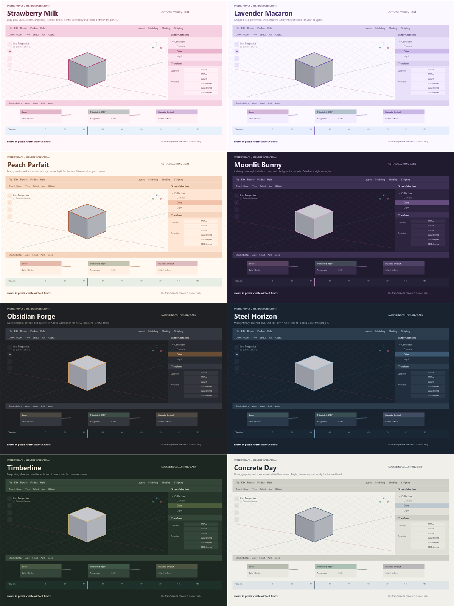

# ♡ cyberstudios / blender.theme.library ✧

**`dream in pixels. create without limits.`**

☁️　🎀　🧊　🫧　💿　✧　🐈‍⬛

*somewhere between a daydream and a 3D viewport.*

---

### ୨୧ a little wardrobe for your workspace ♡

**Four cute palettes. Four masculine palettes. Two original Cotton Candy editions.**

A little strawberry sweetness. A sleepy plum night. Warm bronze, deep pine, cool steel, and quiet stone. Different windows for whatever you're making next, all from **CyberStudios**.

This collection contains **ten Blender XML presets** across nine project folders. Each theme has its own README, and every new palette has an illustrated preview.

**[♡ Open the offline gallery](gallery.html)** — download the HTML and open it in a browser to compare palettes and download individual XML files. All ten preset files are embedded.



*Palette illustrations, not Blender screenshots. The four cute themes are shown first, followed by the four masculine themes.*

---

### 🎀 the cute collection

| Theme | Mode | Little atmosphere |
|---|---|---|
| **[Strawberry Milk](strawberry%20milk/)** | Light | Baby pink, vanilla cream, and berry-colored details. A little strawberry sweetness between the panels. |
| **[Lavender Macaron](lavender%20macaron/)** | Light | Whipped lilac, periwinkle, and soft plum. A tidy little patisserie for your polygons. |
| **[Peach Parfait](peach%20parfait/)** | Light | Peach, vanilla, and a spoonful of sage. Warm light for the next little world on your screen. |
| **[Moonlit Bunny](moonlit%20bunny/)** | Dark | A sleepy plum night with lilac, pink, and starlight-blue accents. Cute has a night room, too. |

### ⌘ the masculine collection

| Theme | Mode | Little atmosphere |
|---|---|---|
| **[Obsidian Forge](obsidian%20forge/)** | Dark | Warm charcoal, bronze, and pale steel. A solid workbench for heavy ideas and careful detail. |
| **[Steel Horizon](steel%20horizon/)** | Dark | Midnight navy, brushed blue, and cool silver. Clear lines for a long view of the project. |
| **[Timberline](timberline/)** | Dark | Deep pine, olive, and weathered brass. A quiet cabin for complex scenes. |
| **[Concrete Day](concrete%20day/)** | Light | Stone, graphite, and a restrained slate-blue accent. Bright, deliberate, and ready for the next build. |

### 🌸 the original cotton candy room

**[Cybercore Cotton Candy · Soft & Vivid](cybercore%20cotton%20candy/)** brings baby pink, lavender, powder blue, and pearl white into Blender. Both original presets are included alongside the eight new themes.

---

### 💾 pick a palette. bring it home.

1. Open a theme folder and download its XML file, or download the **presets ZIP** from the collection's GitHub Release.
2. Extract the ZIP if you downloaded the collection.
3. In Blender, open **Edit → Preferences → Themes → Install…**.
4. Select the XML preset you want. Save Preferences if automatic saving is off.

**Installers only need XML.** The `tools/` folders, palette catalog, preview images, and documentation are source and support files. They are safe to include in the repository upload, and do not need to be installed in Blender.

### 🫧 checked, with a few little notes

- All **ten** presets passed native XML import and export round-trip checks in **Blender 5.2.3 LTS**.
- Each of the eight new themes has **649 color fields** checked against Blender's installed API.
- The new palettes passed 4.5:1 checks for primary text, panel/header/control text, selected text, syntax, and node-header color pairs. This does not establish full accessibility conformance.
- The previews are interface illustrations. Exact Blender spacing, display appearance, and some overlays depend on your settings.
- Other Blender versions have not been tested. No saved Blender preferences were changed during validation.

See [validation.json](validation.json) for the recorded checks.

### 🛠️ for the curious code people

Edit `palettes.json` to change one of the eight new palettes. With Blender available as `blender`, run:

```sh
blender --background --factory-startup --disable-autoexec --python-exit-code 1 --python tools/build_themes.py
```

On Windows, regenerate the palette illustrations with PowerShell, then rebuild the documentation and gallery with Node.js:

```powershell
.\tools\render_previews.ps1
node .\tools\build_docs.cjs
```

The documentation command regenerates the READMEs and gallery from the catalog. Keep hand-edited palette choices in the catalog before rebuilding. Cotton Candy retains its own builder inside its project folder; the collection check validates its current XML files too.

The code, XML themes, and code-drawn previews in this collection use the [MIT License](LICENSE). Preserve required copyright and license notices. Existing third-party terms continue to apply to any separately supplied material.

### 🐈‍⬛ a note from the studio

Cy brings the next idea. Byte finds a comfortable place to watch it happen. Somewhere between them, another workspace starts to feel like home.

**[♡ Explore CyberStudios](https://github.com/cyberthreed/CyberStudios)** · **[💿 Visit the Wiki](https://cyberthreed.github.io/CyberStudios/)**

*Stay curious. Stay creative. Stay a little unreal.*

---

**♡ CYBERSTUDIOS ✧**

**`dream in pixels. create without limits.`**

`made of pixels, daydreams & too many open tabs.`

☁️　♡　🫧　✧　🐈‍⬛　💿
