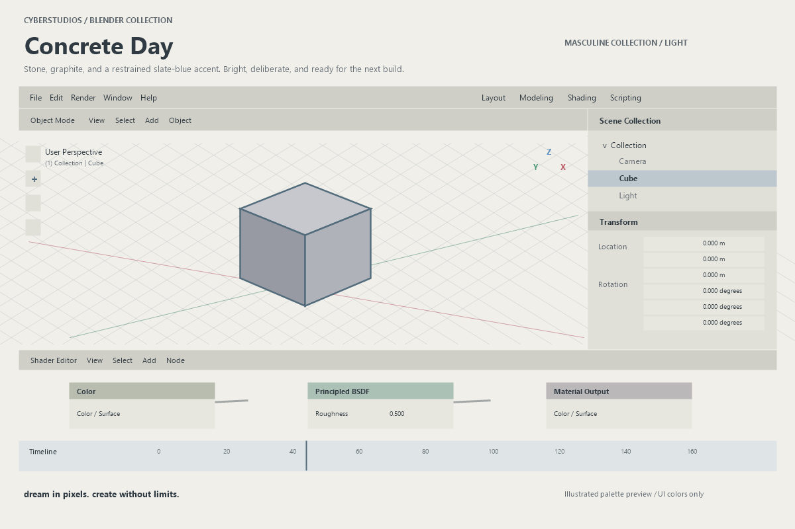

# ♡ concrete day.blend ✧

**`dream in pixels. create without limits.`**

💿　⌘　🧊　✦　☁️

*A grounded workspace with clear lines, deliberate colors, and room for the next build.*

---

### ୨୧ welcome to concrete day ♡

**Stone, graphite, and a restrained slate-blue accent. Bright, deliberate, and ready for the next build.**

Concrete Day is a light Blender theme from the **CyberStudios masculine collection**. Its palette runs through the viewport, sidebars, headers, controls, animation editors, node editor, text editor, and console.

A little atmosphere, from the first cube to the last adjustment.

### 🖥️ a window into the palette

*Illustrated interface preview. It shows the palette, rather than an actual Blender screenshot. Models and materials keep their own colors.*

### ✦ the colors that make it home

| Little home | Color |
|---|---|
| Main editor | `#F0EFEA` |
| Sidebars | `#E0DFD8` |
| Headers | `#CFCFC7` |
| Text | `#303A42` |
| Selection accent | `#526C7C` |
| Animation editors | `#DFE5E7` |

### 💾 bring concrete day home

1. Download [Concrete_Day.xml](Concrete_Day.xml). On GitHub, open the file and use **Download raw file**.
2. In Blender, open **Edit → Preferences → Themes**.
3. Choose **Install…** and select the XML file.
4. Save Preferences if automatic preference saving is turned off.

Also available in the [CyberStudios Theme Switcher](https://cyberthreed.github.io/CyberStudios/projects/theme-switcher.html) add-on, which bundles all twenty themes: [get the add-on](https://github.com/cyberthreed/CyberStudios/releases/tag/blender-theme-switcher-v1.0.0).

**Only the XML file is needed to install the theme.** The collection's tools are for rebuilding its source files.

### 🫧 a few practical little notes

- Validated with **Blender 5.2.3 LTS**. Other Blender versions have not been tested.
- Native import and export round-trip checks passed for **649 colors and 799 attributes**.
- Primary text, controls, selected text, syntax colors, and node-header palette pairs were checked for at least **4.5:1** contrast. This is a palette check, not a full accessibility audit.
- Axis colors keep their familiar red, green, and blue roles. Standard bone and collection color sets remain recognizable.
- The theme changes interface colors. Your geometry, materials, lighting, and render settings stay part of your scene.
- The file contains no add-on and needs no online account.

### ⌘ make a little change

The XML is the installable preset. The collection's [palette catalog](../palettes.json) and [build tools](../tools/) are available for people who want to tune the source. See the [collection README](../README.md) for rebuild steps.

This theme and its source files use the [MIT License](LICENSE). Keep required notices when redistributing.

**[♡ Back to the Blender collection](../README.md)** · **[💿 Visit CyberStudios](https://github.com/cyberthreed/CyberStudios)**

*Stay curious. Stay creative. Stay a little unreal.*

---

**♡ CYBERSTUDIOS ✧**

**`dream in pixels. create without limits.`**

`made of pixels, daydreams & too many open tabs.`

☁️　♡　🫧　✧　🐈‍⬛　💿
