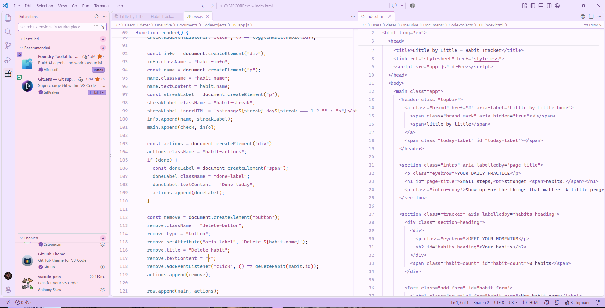

# Cybercore Cotton Candy V1 Pastel Syntax Edition🩷

*A dreamy, pastel VS Code customization preset by CyberStudios.*

Cybercore Cotton Candy transforms Visual Studio Code into a soft, nostalgic digital workspace inspired by pastel vaporwave, dreamy Y2K interfaces, liminal aesthetics, and Frutiger Aero.

## Features

- 🌸 Baby-pink sidebar and Explorer
- 💜 Lavender tabs and title bar
- ☁️ Pearl-white code editor
- 🫧 Powder-blue terminal
- ✧ Pastel syntax highlighting
- 🎀 Coordinated buttons, notifications, and interface accents

## Installation

1. Install [Visual Studio Code](https://code.visualstudio.com/).
2. Install the [GitHub Theme](https://marketplace.visualstudio.com/items?itemName=GitHub.github-vscode-theme) extension.
3. Open VS Code.
4. Press `Ctrl + Shift + P`.
5. Select **Preferences: Open User Settings (JSON)**.
6. Back up your existing settings.
7. Copy the contents of this project's `settings.json` into your settings file, or merge them with your existing preferences.
8. Save and enjoy!

## Preview

## Notes

This is a VS Code settings preset, not a standalone Marketplace extension.

Some colors may vary depending on your installed extensions and operating system.

## ✧ About CyberStudios
CyberStudios is an independent creative technology studio exploring game development, adaptive AI gameplay systems, digital art, modding, and experimental interactive experiences.

Cybercore Cotton Candy is part of the studio's creative customization collection.

## Credits

Created by **CyberStudios**.

*Dream in pixels. Create without limits. ✧*
